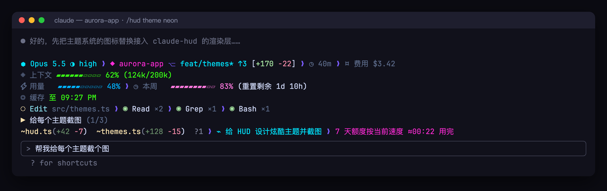
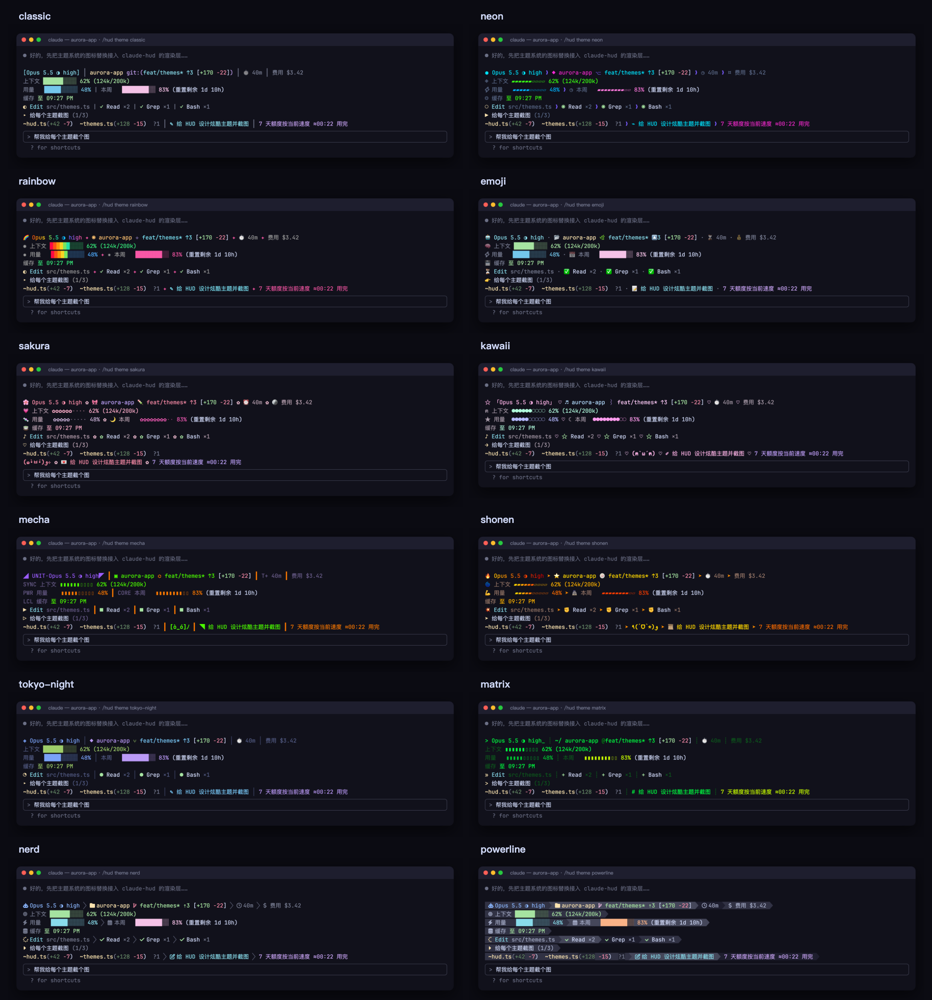
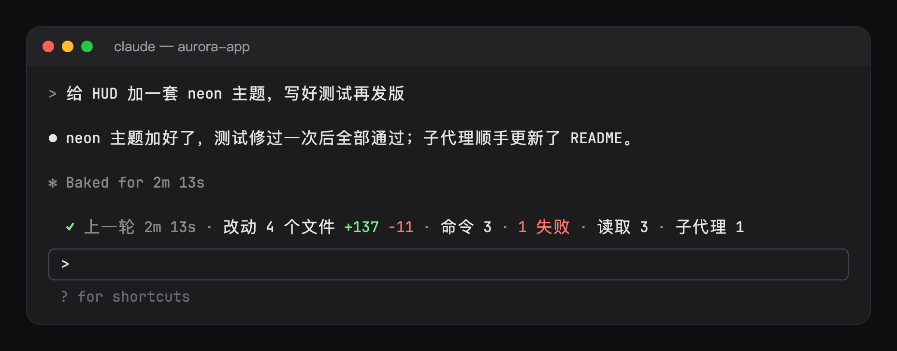
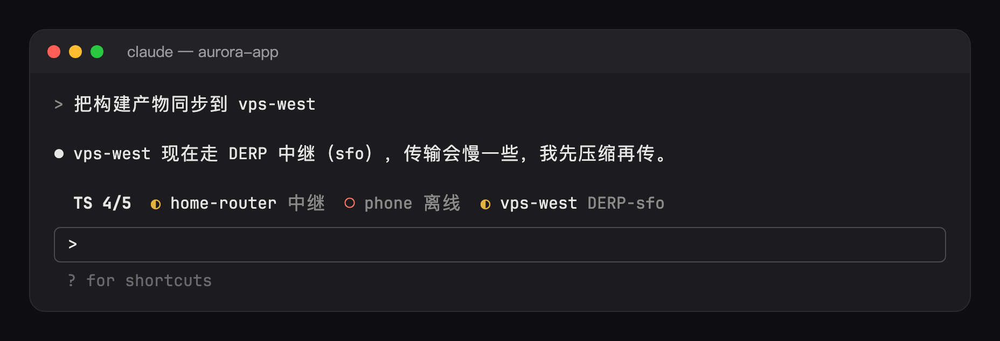
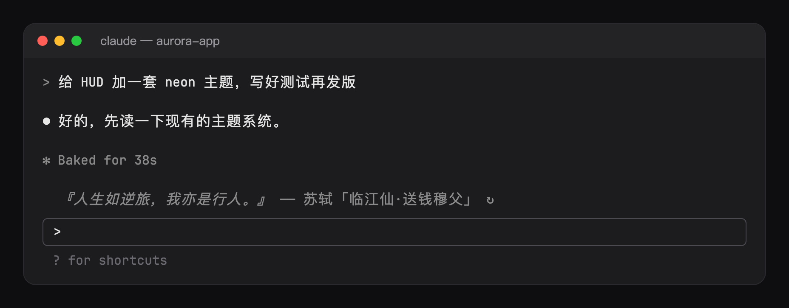

<div align="center">

# hoobnn-agent-mods

Claude Code 状态栏 HUD，附带任务进度条、回合回执、运行动画等 mod。

[](LICENSE)

**简体中文** · [English](README.en.md)

</div>



[`hud`](claude-code/hud) 把 [claude-hud](https://github.com/jarrodwatts/claude-hud) 改成了 Claude Code mod：模型、项目、git、上下文、用量、正在跑的工具、子代理和待办都集中在输入框旁边，可以放在输入框上方，也可以放在下方原来状态栏的位置，终端和 Claude Desktop 都能用。在 claude-hud 的基础上，它还加了额度预警、用量耗尽预测、每日预算、一行任务摘要、`/hud detail` 详情面板和 12 套主题。

## 快速开始

```sh
claude plugin marketplace add hoobnn/hoobnn-agent-mods
claude plugin install hud@hoobnn-agent-mods
```

装好后 HUD 默认显示在输入框上方。用 `/hud theme` 选主题，`/hud detail` 打开详情面板，`/hud off` / `/hud on` 隐藏或显示。已有的 claude-hud 配置（`~/.claude/plugins/claude-hud/config.json`）会直接沿用。

## HUD 功能

- **claude-hud 原有的信息**：模型和推理强度、项目和 git 分支及改动、上下文和用量进度条、正在跑的工具、子代理和待办。
- **提前预警**：上下文或额度到设定的百分比时弹提示；按当前速度预测额度何时用完；Fable 这类按模型单独计的周额度也一起显示和预警；距自动压缩还剩多少 token。
- **省钱提醒**：提示缓存过期后，提醒下一条消息要重新写入多少 token；某一轮让上下文涨得特别多时，显示涨幅和最近几轮的迷你柱状图（如 `上一轮 +98k ▂▁█`）；今天的花费对比每日预算。
- **任务概览**：每隔几轮生成一行任务摘要；`/hud detail` 面板列出每个工具的调用次数和耗时、最近几轮的用时和花费、子代理、待办、今天和本周的花费。
- **其他**：未提交改动或未推送提交太多时提醒；长任务结束提醒（macOS 可加提示音）；远程控制的连接状态。
- **12 套主题**：`classic`、`neon`、`rainbow`、`emoji`、`sakura`、`kawaii`、`mecha`、`shonen`、`tokyo-night`、`matrix`、`nerd`、`powerline`，其中动漫风主题带会随状态变脸的颜文字看板娘。

<details>
<summary>12 套主题总览</summary>



</details>

完整的命令、选项和实现细节见 [`claude-code/hud`](claude-code/hud)。

## 更多 mod

| Mod | 作用 |
| --- | --- |
| [`todo-bar`](claude-code/todo-bar) | 任务进度条：显示当前任务、已用时长、完成进度以及各子代理的工作内容；仅读取 TodoWrite / Task 工具的结果，不消耗 token |
| [`receipt`](claude-code/receipt) | 回合回执：每轮结束后用一行汇总改动的文件数、增删行数、执行的命令数和失败数，标出改了代码但未运行测试的情况，并可逐处回放每次改动的 diff；Claude 陷入重复操作时发出提醒，不消耗 token |
| [`spinner`](claude-code/spinner) | 运行动画与宠物伴侣：像素风动画场景（雷霆战机、Clawd、吃豆人、彩虹猫、系统音频频谱等 15 套主题），宠物随 Claude 的操作变换姿态并可升级，每轮结束时播放彩带动画 |
| [`ts-band`](claude-code/ts-band) | Tailscale 节点状态：所有节点直连时仅显示一个小标记，有节点经中继连接或离线时才列出，节点上线或掉线时弹出提示 |
| [`hitokoto`](claude-code/hitokoto) | 在输入框上方显示一句[一言](https://hitokoto.cn)及出处，支持定时、每日、每个会话或每条消息刷新 |

| `todo-bar` | `receipt` |
| --- | --- |
|  |  |
| `ts-band` | `hitokoto` |
|  |  |

`spinner`（`clawd` 主题跑完一轮，宠物伴侣的气泡跟着工具变化，最后放庆祝动画；15 套主题的动图见 [`claude-code/spinner`](claude-code/spinner)）：


<sub>截图均由 mod 实际绘制的内容渲染。</sub>

## 安装

先添加本仓库的插件市场，再安装需要的 mod，每个 mod 都可单独安装、开箱即用：

```sh
claude plugin marketplace add hoobnn/hoobnn-agent-mods
claude plugin install hud@hoobnn-agent-mods
claude plugin install todo-bar@hoobnn-agent-mods
claude plugin install receipt@hoobnn-agent-mods
claude plugin install spinner@hoobnn-agent-mods
claude plugin install ts-band@hoobnn-agent-mods
claude plugin install hitokoto@hoobnn-agent-mods
```

### 更新

```sh
claude plugin marketplace update hoobnn-agent-mods
claude plugin update <mod>@hoobnn-agent-mods
```

### 卸载

```sh
claude plugin uninstall <mod>@hoobnn-agent-mods
```

## 使用

选项（`hud` 的 `position`、`theme`、`dailyBudgetUsd`、`summaryEveryTurns`，`ts-band` 的 `nodes`、`hideOffline`，`hitokoto` 的 `refreshMode`、`categories`，`spinner` 的 `theme`、`stage`、`celebrate`、`companion` 等）都能在 `/config` 里改，也可以写在 `~/.claude/settings.json` 的 `pluginConfigs` 里。所有 mod 设置统一保存在 `/config`，斜杠命令修改的设置（`/hud theme neon`、`/ts off`、`/spinner stage off`）也会写回这里；每个 mod 都有 `visible` 选项，`/hud`、`/ts`、`/hitokoto`、`/spinner`、`/todos`、`/receipt` 的 `off` / `on` 改的就是它。每个 mod 的完整说明见各自目录下的 README。

这些 mod 都支持英语、简体中文、繁体中文、日语、韩语、西班牙语、法语、德语、巴西葡萄牙语和俄语。`hud` 跟随 claude-hud 配置里的 `language`；`ts-band`、`hitokoto`、`spinner`、`todo-bar` 和 `receipt` 有各自的 `language` 选项，默认 `auto`，依次跟随 Claude Code 的 `language` 设置、系统语言环境，都没有时用英语。

## 仓库结构

Claude Code 的六个 mod 放在 `claude-code/`。其他编程 Agent 工具的扩展按工具分目录存放，目前 `pi/` 和 `deepseek/` 只有说明文件，还没有收录扩展。

| 目录 | 对应工具 | 放什么 |
| --- | --- | --- |
| `claude-code/` | [Claude Code](https://code.claude.com) | mod（函数钩子插件），每个子目录都能用 `claude --plugin-dir` 单独加载；`kit/` 例外，放各 mod 共用的代码 |
| `pi/` | [pi](https://github.com/earendil-works/pi) | 扩展 |
| `deepseek/` | [DeepSeek Harness](https://github.com/deepseek-ai/deepseek-harness) | `dsh` 插件 |
| `shared/` | 不限 | 多个工具的移植版都要用到的逻辑 |
| `scripts/` | | 检查、kit 同步和截图渲染脚本 |

## 开发

- 用工作副本覆盖已安装的版本：`claude --plugin-dir claude-code/<mod>`。会监听文件，保存后钩子模块自动重新加载。
- 每个 mod 在 `hooks/config.ts` 里一次性读出选项（类型化的 `Config`）；`hooks/register.tsx` 放钩子和所有调用 `$` 的代码（引擎只在这个文件内追踪 `$`）。
- 各 mod 共用的代码放在 `claude-code/kit/`（语言解析、选项读取、横条叠放、写回 `/config`）。安装后的 mod 读不到自己目录以外的文件，所以由 `scripts/sync-kit.sh` 把每个 mod 用到的 kit 文件复制进它的 `hooks/kit/`：改 `claude-code/kit/`，再跑一遍脚本；副本过期时 `scripts/check.sh` 会报错。
- `scripts/check.sh` 先检查 kit 副本，再校验、测试并类型检查所有 mod，并按 [awesome-claude-code-mods](https://github.com/karanb192/awesome-claude-code-mods) 的规则列出每个 mod 的触及范围（L0 只绘制、L1 读取、L2 写入或运行、L3 联网）；超过 `scripts/reach.txt` 里给它定的等级就报错。mod API 还在早期阶段，Claude Code 升级后也跑一遍。`tsc` 需要的类型文件由 Claude Code 在第一次加载 mod 时放进 `.claude-plugin/types/`。
- `bun scripts/spinner-shots.ts` 用 `spinner` 自己的帧表重新渲染它的 GIF 和静态图（需要 ffmpeg 和 Playwright 的 Chromium）。
- `bun scripts/mod-shots.ts [<mod> ...]` 重新渲染 `ts-band`、`hitokoto`、`todo-bar`、`receipt` 的预览图：把 `scripts/shots/<mod>.tsx` 临时放进该 mod 的 `tests/` 跑一遍，取出横条真实画出的元素树，再套上终端窗口截图（需要 Playwright 的 Chromium）。
- 发布：把 mod 的 `plugin.json` 和 `.claude-plugin/marketplace.json` 里对应条目的 `version` 改掉，提交，然后执行 `claude plugin tag claude-code/<mod> --push`（tag 格式是 `<mod>--v<version>`）。已安装的用户按「更新」一节的命令升级。

## 许可证

[MIT](LICENSE) © 2026 hoobnn。可自由使用、修改和分发，需保留版权声明。

`claude-code/hud/hooks/hud` 是 claude-hud 的源码，沿用它自己的 MIT 许可（见 `claude-code/hud/LICENSE.claude-hud`）。
